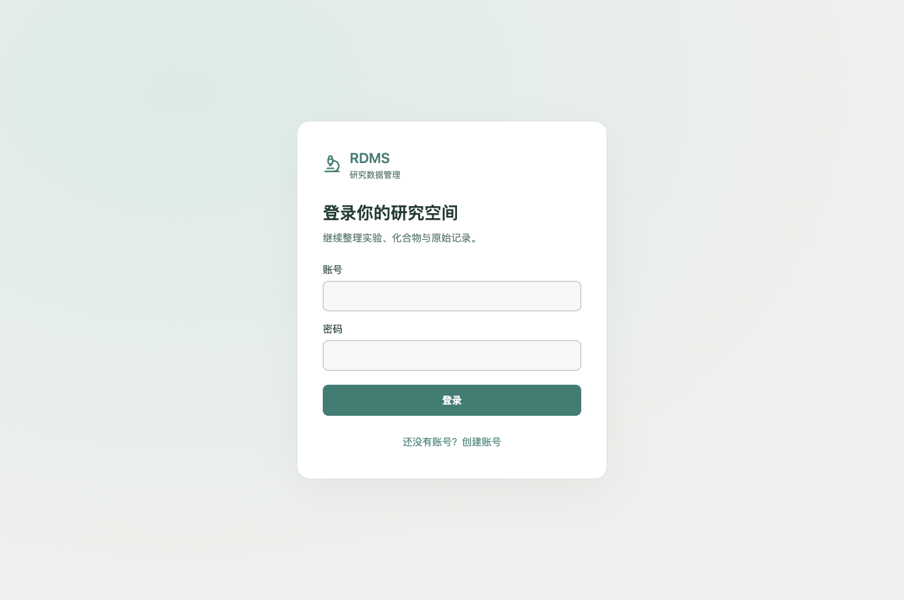
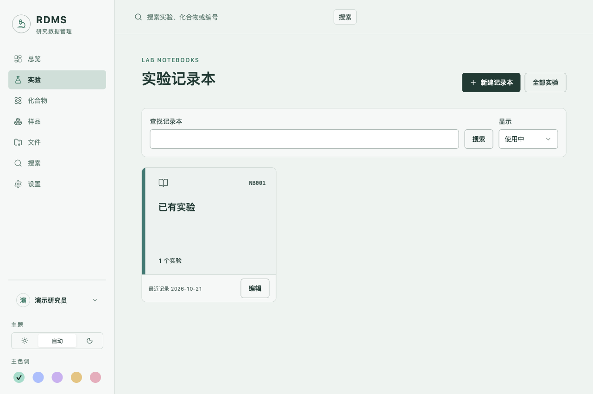
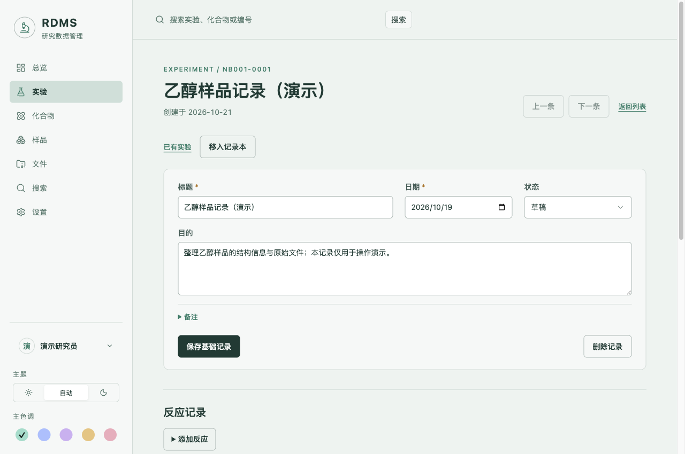
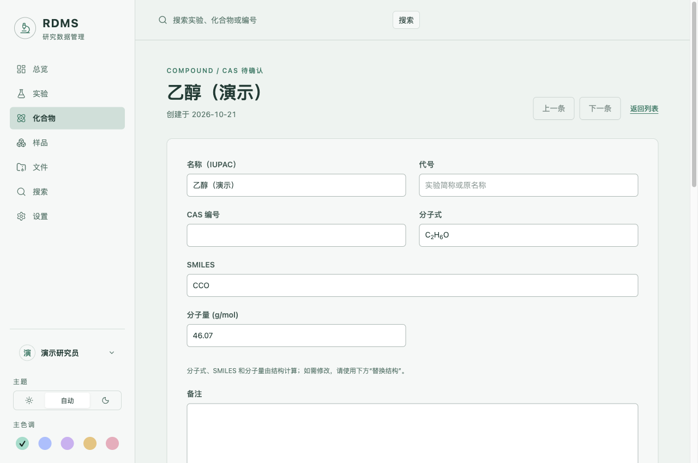

# RDMS

RDMS 是面向化学与生命科学研究的个人电子实验记录本。你可以把实验步骤、化合物、反应投料、产物、样品和原始文件放在一起，方便记录、查找和复用。

桌面版在自己的电脑上运行，实验记录和附件保存在本机。日常记录无需云端账号，也不会自动同步到其他设备。查询外部化学资料时需要联网。

[下载页面](https://github.com/YCMiao/RDMS/releases) · [反馈问题](https://github.com/YCMiao/RDMS/issues) · [安装与首次使用](#安装与首次使用) · [记录第一个实验](#记录第一个实验)

## 下载前先看这里

**当前桌面版处于内部测试阶段，尚未发布正式下载版本。** 截至 2026 年 10 月 21 日，GitHub Releases 暂无发布条目；本地已有 `0.1.0-beta.1` 的 Mac 测试包。请以之后发布页面列出的附件和说明为准。

| 你的电脑 | 当前状态 |
|---|---|
| Apple 芯片 Mac（M 系列） | 已有内部测试包；配置要求 macOS 13 或更新版本，现有安装验证在 macOS 26.6.2 完成 |
| Intel 芯片 Mac | 尚未提供经验证的安装包 |
| Windows | 尚未构建并验证安装包 |

Mac 测试包尚未完成正式开发者签名与公证，系统可能阻止打开。当前版本的桌面备份恢复、升级和异常退出保护也尚未完成完整验收，建议先用测试资料体验。

### 发布后如何下载

1. 打开 [Releases 下载页面](https://github.com/YCMiao/RDMS/releases)。
2. 选择一个版本，先阅读它的系统要求和已知问题。标注 **Pre-release** 的版本是测试版。
3. 展开 **Assets**，下载与你的系统和芯片匹配的安装包。Mac 的 `arm64` 表示 Apple 芯片；Windows 的 `x64` 表示常见的 Intel／AMD 64 位电脑。
4. 不要把 GitHub 自动生成的 **Source code (zip)** 或 **Source code (tar.gz)** 当成安装程序，它们是源码。

当前 Mac 测试包的名称是 `RDMS-0.1.0-beta.1-arm64.dmg`。这只是现有本地包的名称，不表示下载页面已经提供该文件。

## 安装与首次使用

### 在 Mac 上安装

获得与本机匹配的测试包后：

1. 双击 `.dmg` 文件打开安装盘。
2. 将 **RDMS.app** 复制到“应用程序”文件夹。
3. 从“应用程序”打开 RDMS，等待启动完成。随包包含所需运行环境，无需另装 Python、数据库或 Docker。
4. 如果系统提示无法验证开发者或阻止运行，记录提示并联系维护者获取适合分发的版本。不要通过关闭系统安全保护来安装。

Windows 的安装步骤会在对应安装包验证完成后补充；目前不把尚未验证的 Windows 构建流程作为用户教程。

### 创建本地账号

*Mac 桌面测试版实机截图；下文记录均为独立临时资料库中的演示数据。*

1. 在登录页面选择注册，填写用户名、显示名称和密码。
2. 用户名使用 3–40 位英文字母、数字、点、下划线或连字符；密码长度为 12–128 个字符。
3. 注册后进入自己的数据空间。以后使用同一账号登录即可继续查看本机记录。

账号仅用于当前安装的数据空间，不是云端账号。同一安装中的不同账号各有独立记录；换电脑登录不会自动带回原来的实验。请妥善保存密码，当前没有邮件找回密码功能。

点击界面中的用户名，可以修改密码或退出登录。

## 记录第一个实验

建议先创建一条练习记录，熟悉保存方式后再开始整理资料。

### 1. 创建实验记录本

打开“实验”，创建一本记录本，例如“催化反应筛选”或“2026 合成实验”。记录本可以改名或归档，“全部实验”用于跨记录本查找。

进入记录本后新建实验，填写标题和日期。系统自动分配类似 `NB001-0001` 的编号，无需手工编写；删除实验后编号不会重复使用。

### 2. 填写基础记录

填写实验目的、状态和备注，然后点击 **保存基础记录**。

**不同区域分别保存。** 保存基础记录不会替你保存尚在编辑的反应、投料、产物或附件信息。每个区域操作后，确认它自己的保存反馈再离开页面。

### 3. 添加反应与投料

在实验中添加反应，再点击 **添加反应物**。你可以选择已有化合物、填写 CAS 号查找，或手动录入。

- 填写当量（eq）、物质的量（mmol）及投料质量或体积。
- 需要联动计算时，选定一个“限制反应物”，其当量固定为 1 eq。
- 已指定限制反应物时，调整其他反应物的 eq 会计算相应 mmol 和可换算的质量。
- 修改 mmol 或质量并保存，可能改变整个反应的投料规模；保存前核对各行用量。
- 体积需要手工填写，系统不会默认用 mmol 推算体积。

溶剂在独立的溶剂区域添加。一个实验可以包含多个反应，通过反应区域的上一页／下一页切换。

### 4. 记录产物和条件

在“产物与收率”中选择或新建产物，填写实际产量。具有有效限制反应物、产物计量比和分子量时，系统可以计算收率；也可以手工填写。

温度可使用 °C、K 或“室温”等文字；时间可使用小时、分钟或“过夜”等描述。填写后保存，并在反应总览中核对显示结果。

计算结果用于辅助记录，尤其在改变反应规模后，应核对投料与收率是否符合实际实验。

### 5. 添加样品和原始文件

按需要创建样品，并在实验文件区域上传对应的谱图、照片或数据文件。

支持 PDF、CSV、TXT、PNG、JPEG、JCAMP-DX 和 ZIP，默认单文件上限为 100 MiB；多文件逐个上传。上传后可以下载核对，并编辑文件说明。

### 6. 查找与复用

- 使用顶部搜索框查找实验和化合物。
- 在实验列表中按日期、编号或标题排序。
- 使用 **复制实验** 创建相似实验的新草稿；它会复制部分实验设置与反应记录，但不会带入统一备注、样品或附件，创建后仍需核对内容。
- 在实验详情生成、复制或下载 Markdown 摘要，方便整理文字记录。**摘要不等于包含附件的完整备份。**

## 管理化合物

### 根据 CAS 号建立资料

进入“化合物”，选择 **根据 CAS 号新建**，输入 CAS 号。系统优先查找本机资料，本机没有时再尝试查询外部来源。

核对名称、化学式和结构后再保存。查不到或结果不能确认时，可以手工建档；“CAS 待确认”表示尚未取得可靠编号，不需要猜填。

已有记录缺少结构时，可以使用 **按 CAS 补全结构**。外部结果仍需要与实际使用的化合物、盐型及立体结构一致。

### 从 ChemDraw 导入结构

1. 在 ChemDraw 中选中单个明确分子。
2. 使用 **Copy As → MOL** 或 **Copy As → SMILES**。
3. 在 RDMS 的结构导入页面粘贴并预览；也可以选择 `.mol`、单记录 `.sdf`、`.smi` 或 `.cdxml` 文件。
4. 核对结构与本地计算的分子式、分子量等信息，再保存。

普通复制可能只得到图片；遇到这种情况，请使用 Copy As 或文件导入。含 R 基、查询原子或多个分子的内容需先整理。

密度、熔点、沸点等实验性质不能仅靠二维结构可靠推算。需要这些资料时，可选择查询外部来源，并核对来源与测量条件。

## 删除、恢复与外观

删除后的记录可以在“设置”的回收站中查看。若恢复受到关联记录限制，先按页面提示恢复相关记录；恢复实验时需要选择目标记录本，并会获得新编号。

删除标签只会移除分类关联，不会删除科研记录。当前不提供清空回收站或永久删除全部数据的操作。

通过侧栏底部的外观入口，可以选择浅色、深色或跟随系统，并更换配色。

## 数据保存与联网范围

桌面版将账号、实验记录和附件保存在本机应用数据目录，独立于应用安装文件。关闭后重新打开，可以继续查看已经保存的记录。

请注意：

- 换设备不会自动同步，桌面版也不会自动读取原 Docker 自用版的账号或资料。
- 本机记录和结构计算可以离线进行；外部化学资料查询需要网络。
- CAS 查找在本机无结果时，可能向 PubChem 发送 CAS 号；结构性质查询可能发送 InChIKey。
- 未发表或敏感结构可仅在本地导入，跳过外部查询。当前桌面版尚未提供经过验收的统一“关闭所有外部查询”开关。
- 本地保存不等于文件已经加密，也不等于已经有备份。

### 备份、更新与换电脑

当前桌面测试版**尚未提供可供普通用户使用、经过验收的完整备份恢复与设备迁移流程**。原源码版的 Docker 备份命令不适用于桌面版。

在这些功能完成前，请保留原始资料，不把当前测试版当作唯一档案。升级前先阅读对应版本的说明；已有重要记录时，先联系维护者确认备份与兼容性，再更换版本。不要直接删除数据目录，也不要用旧版本尝试打开较新版本的数据。

## 常见问题

**为什么 Releases 页面没有安装包？**

目前尚未创建发布条目。源码下载不能代替桌面安装包；请等待维护者发布支持你所在系统的版本。

**保存了基础记录，为什么投料修改没有保存？**

各区域独立保存。请确认投料或反应编辑区域也已保存成功。

**CAS 查询失败会影响继续记录吗？**

不会阻止手工录入或使用本机已有化合物。查询可能受网络、来源权限或资料缺失影响，不要将查询失败理解为化合物不存在。

**登录另一台电脑，为什么看不到实验？**

数据保存在原电脑；当前没有云端同步，也没有完成桌面设备迁移功能。

**提示记录已被修改怎么办？**

先保留尚未保存的输入，再刷新核对最新记录后重新编辑，避免覆盖更新内容。

**遇到打不开、上传失败或计算异常怎么办？**

在 [Issues](https://github.com/YCMiao/RDMS/issues) 提交系统版本、芯片类型、RDMS 版本、复现步骤和错误截图。截图和日志请先去除密码、个人信息以及未发表的实验内容。

## 给开发者与自行部署者

普通桌面用户无需运行构建或数据库命令。需要从源码启动、维护现有 Docker 自用版或参与开发时，请阅读：

- [源码运行与维护参考](docs/source-operation.md)
- [桌面应用开发指南](docs/desktop-development-guide.md)
- [数据安全与恢复设计](docs/data-safety.md)
- [当前开发进度](PROGRESS.md)与[验收记录](docs/verification.md)

桌面实现目前位于 `codex/desktop-app` 分支，与 `main` 的源码运行方式有所不同。
