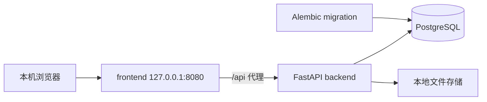

# 系统架构与设计决策

状态：阶段 00–08 已实现；实际验收见 [verification.md](verification.md)。需求依据：工程根目录 prompt0922.docx 及用户确认的本机个人使用、基础完整闭环、分阶段交接。

## 总体结构



frontend 为构建后的静态资源与同源代理服务。backend 和 db 仅在 Compose 内网通信，不发布主机端口。数据库健康后执行一次性 migration 服务，迁移成功才启动 backend。业务启动不得调用 create_all 替代迁移。迁移失败保留错误并停止就绪，不自动回退到空数据库。

主界面默认 127.0.0.1:8080；所有运行数据使用持久化挂载。普通停止和重启不能删除数据。禁止把 `docker compose down -v` 当作常规关闭步骤。无需账号仅适用于此部署边界；未来远程访问必须先另行设计身份验证和访问控制。

## 依赖与运行基线

采用原文推荐技术栈。阶段 01 已验证并锁定容器基线为 Python 3.12.11、Node.js 22.20.0、PostgreSQL 17.6、nginx 1.29.1；前端提交 npm lockfile，Python 直接依赖使用精确版本清单（传递依赖尚未完整锁定），镜像使用明确补丁标签。前端安全更新后的 lockfile 由 npm 11 生成，并已由 Node 22 镜像自带的 npm 10 通过 `npm ci`、测试和生产构建验证可重复消费。依赖新增前写清用途，不因方便加入新的数据库、队列或服务。

补充依赖职责：SQLAlchemy 同步 Session 配合 psycopg；Pydantic Settings 管理环境配置；python-multipart 支持文件上传；pytest/httpx 做后端测试；Ruff 与 mypy 做后端静态检查；ESLint、TypeScript、Vitest、Testing Library 做前端检查；Playwright 做核心浏览器验收；openapi-typescript 生成接口类型。前端用 React Router 和 TanStack Query 管理路由及服务端状态。不得把密码、上传数据或真实实验夹具提交到版本库。

使用同步数据库访问时采用 FastAPI 同步路由或明确线程隔离，不能在 async 路由中直接执行阻塞数据库/文件操作。文件上传全程分块处理，不能一次读入全部内存。

## 工程组织

```text
RDMS/
  PROGRESS.md / BLOCKED.md
  README.md / .env.example / .gitignore
  docker-compose.yml / docker-compose.e2e.yml
  docs/                       现役设计、运维与验收
  backend/
    app/
      api/                    路由、参数、依赖、响应映射
      models/                 SQLAlchemy 模型
      services/               业务规则与事务
      repositories/           查询与持久化
      core/                   配置、异常、请求来源防护
      db/                     Session 与元数据
      main.py
    alembic/ / tests/
  frontend/
    src/
      components/ / features/ / lib/
      services/ / hooks/ / types/ / test/
    e2e/                      浏览器端到端验收
  scripts/                    check.sh、rdms_data.py
  data/                       运行数据，不入版本库
```

后端 Dockerfile 的 `base` 安装运行依赖；`test` 增加检查工具与测试文件；默认最终 `runtime` 阶段只复制 app、alembic 和配置，以非 root 用户运行。Compose 的 backend-test 显式选择 test；迁移及 E2E 后端使用 runtime，确保验收覆盖正式镜像。

service 拥有事务边界；repository 不自行 commit。跨实体操作必须在同一事务中检查父记录、版本及引用约束。路由不直接拼 SQL，不散落重复业务规则。前端页面负责布局，feature 承载业务交互，共享组件不依赖具体页面。不要为了分层为每个简单字段创建抽象接口，也不要把所有业务放进巨型 service。

## 配置与公开接口

.env.example 至少说明 DATABASE_URL、POSTGRES_DB/USER/PASSWORD、APP_TIMEZONE、UPLOAD_ROOT、MAX_UPLOAD_BYTES、APP_HOST_PORT、LOG_LEVEL。默认值分别为容器数据库地址、明确的开发占位凭证、Asia/Shanghai、容器绝对存储根目录、104857600、8080、INFO。真实 .env 忽略；数据库密码不得写进前端构建参数。

接口保持 REST 风格；OpenAPI 为生成前端类型的来源。开发时使用 Vite 同源代理，部署时通过静态服务代理；不开放通配 CORS。运行配置读取失败立即给出可读错误，不悄悄连接测试库或创建另一个存储位置。对于无账号本机模式，写入 API 限制浏览器 Origin 为本应用来源并验证 Host，防止其他网页对本机服务发起跨站写入；无 Origin 的本机命令行请求允许。

## 设计决策及潜在问题

| 问题 | 当前决策 | 影响 |
|---|---|---|
| 实验和化合物并非总有反应关系 | 增加显式关联表，查询与样品/反应关系取并集 | 不会丢失非反应实验的关联 |
| 一个实验可能包含多次反应 | Experiment 一对多 Reaction | 界面使用反应列表而非单一字段 |
| 产物收率 | product 保存 yield_percent、stoichiometric_ratio，反应物可标记 is_limiting | 支持质量与计量比自动计算及手动值，规则见 reactant-table.md |
| 样品可能是混合物 | compound_id 可空，experiment_id 必填 | 单一化合物字段不伪装为完整组成表 |
| 化学结构与身份 | RDKit 本机解析结构并生成 InChIKey；文本搜索仍为子串匹配 | 同结构提示不自动合并，CAS 与实验性质需核对来源 |
| 数据库与文件不能共享原子事务 | 临时文件、原子发布、失败补偿与只读检查 | 异常后可能存在待人工处理的孤立文件 |
| 软删除容易误恢复子记录 | 子记录自身删除状态与父可见性分离 | 恢复父记录不复活单独删除的内容 |
| 无登录有明确环境限制 | 只绑定回环地址并检查来源 | 不直接适配实验室共享部署 |
| 自动摘要容易变为科学推断 | 固定模板，缺失值明确标记 | 不产生不存在的实验结果 |
| 全阶段验收 | `scripts/check.sh all` 运行后端、前端和浏览器测试 | 实际结果见 verification.md |

## 后续扩展

已实现 RDKit 结构解析、描绘与派生值计算。未来谱图解析、文献检索以独立业务模块接入，复用实体 ID 和 FileAsset。不预建插件框架、向量库、任务队列或空接口。长任务、数据版本、审计、多用户在明确需求后另做迁移。原始文件始终不可原地覆盖；未来处理结果应另建文件并记录来源。

## 阶段 02 实施记录

初始业务 schema 通过 `9dd700ef716a_stage02_schema.py` 从阶段 01 空基线增量迁移，未用 `create_all`。状态/角色采用有 CHECK 约束的字符串列，与文档中的取值集合一致；未来扩充取值需迁移 CHECK。`FileAsset` 以 `(sample_id, experiment_id)` 复合外键引用 `Sample(id, experiment_id)`，在数据库层拒绝跨实验挂样品。`Sample` 因此增加对应的复合唯一键；这是为了落实原文同实验要求，不改变实体或 API。自动编号在调用方事务内分配，业务插入失败时编号分配一并回滚。
