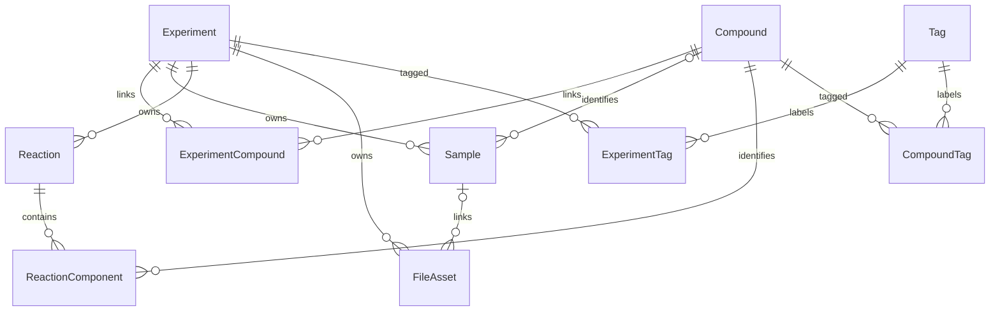

# 数据模型与约束

状态：阶段 02 已按本规格建立数据库模型与迁移；业务 API 和操作规则待后续阶段。字段未特别说明时不能由客户端写入 id、编号、创建时间、删除时间或版本。

## ER 图

## 通用规则

实体 id 使用 UUID，created_at/updated_at/deleted_at 使用 timestamptz，时间保存 UTC、展示时转换 APP_TIMEZONE。普通业务实体带 version 正整数，创建为 1，任何更新、删除、恢复原子递增。Tag 不做软删除但带 version。关联表不带业务编号。科研数值使用 Numeric(20,8)，JSON 用十进制字符串传递，禁止经过 JavaScript Number 静默损失精度。除温度外数值不得为负；收率可大于 100，以保留原始记录并在 UI 提示复核。

业务代码不可编辑，唯一索引包含软删除记录。普通文本去除首尾空白，保留内部换行；SMILES 只去首尾空白，不重新编码结构。名称非空；备注和长文本允许空。外键限制物理删除，唯纯关联表可随标签删除清理。

## 实体字段

### Experiment

- experiment_code：唯一非空，自动生成；title：非空，最多 300 字符。
- date：必填 date；objective、procedure、observation、result、conclusion：可空 text，每项上限 100000 字符。
- status：draft / in_progress / completed / cancelled，默认 draft；允许任意状态间切换，不设签署或不可逆完成流程。
- 具备通用时间戳、version、deleted_at；title/code 用于文本检索，date/id 用于稳定排序。

### Compound

- compound_code：唯一自动编号；name：非空，最多 300 字符。
- smiles：可空，最多 10000 字符；molecular_formula：可空，最多 200 字符。
- molecular_weight：可空 Numeric(20,8)，大于 0，约定 g/mol；notes：可空 text。
- 同名或相同 SMILES 不设唯一约束，编号才是身份标识。具备软删除与版本。

### ExperimentCompound

experiment_id、compound_id 组成复合主键，created_at；不承载当量、剂量等反应信息。关联和解除仅影响显式关系，不移除通过 Sample 或 ReactionComponent 形成的关系。

### Sample

- sample_code：唯一自动编号；name：可空，最多 300 字符；experiment_id：必填且创建后不可迁移到另一实验。
- compound_id：可空；sample_type：非空，最多 100 字符，自由文本。
- amount 与 unit 同时为空或同时填写；unit 最多 50 字符，允许用户科研单位文本。
- concentration 与 concentration_unit 同时为空或同时填写；notes：可空。
- 包含软删除和版本。compound_id 可编辑，但不得引用无效化合物。

### Reaction

experiment_id 必填且不可变；reaction_name 非空、最多 300 字符；temperature_c、reaction_time_hours 可空；atmosphere、solvent 可空、最多 300 字符；notes 可空。含软删除和版本。solvent 是条件描述，ReactionComponent 中的 solvent 用于定量记录，两者不自动相互覆盖。

### ReactionComponent

reaction_id、compound_id 必填；role 为 substrate / reagent / catalyst / ligand / base / solvent / additive / product。amount 和 unit 成对可空；mmol、equivalents、yield_percent 可空且非负。yield_percent 仅 product 可填。sort_order 为非负整数，默认追加到末尾；notes 可空。含软删除和版本，不对 reaction/compound/role 组合去重，以允许分次加料。未给数量的组分允许保存，界面显示“未记录”。

### FileAsset

experiment_id 必填；sample_id 可空且必须属于同一实验；original_filename 保留上传文件原名，最多 255 字符，拒绝 NUL/控制字符和路径分隔符；filename 为服务端 UUID 文件名；file_path 为相对 UPLOAD_ROOT 的存储键，禁止输出给客户端；file_type 为规范化类型；file_size 为 bigint；sha256 为 64 位小写十六进制；instrument_type 为可空自由文本；uploaded_at 为服务端时间；notes 可空。具备通用版本、软删除。普通 PATCH 仅允许 sample_id、instrument_type、notes；二进制内容永不覆盖，替换需新建 FileAsset。

### Tag 和关联表

Tag：id、name（非空最多 50 字符）、normalized_name（去首尾空白并 Unicode casefold 后唯一）、created_at、updated_at、version。ExperimentTag/CompoundTag 分别采用对象 ID 与 tag_id 复合主键。标签是分类，不承载权限。删除标签永久删除分类及其关联，绝不删除实验或化合物；UI 明示。

### NumberCounter

namespace（EXP/CMP/SMP）、year（CMP 固定 0）、next_value（bigint，大于 0），前两列复合主键。初始化使用 INSERT ON CONFLICT DO NOTHING，再使用原子 UPDATE RETURNING 或行锁取号。与业务插入处于同一数据库事务。

EXP-YYYY-0001、SMP-YYYY-000001 的 YYYY 使用服务端创建时 APP_TIMEZONE 年份；CMP-000001 不分年。显示宽度是最小宽度，无硬性位数上限。允许失败事务回滚尚未成功发行的编号；已经提交的编号永不因删除重用。允许跳号，不追求连续无缺口。

## 可见性、删除及并发

有效 Sample 要求自身和所属 Experiment 均未删除；Reaction 同理；ReactionComponent 还要求 Reaction 有效；FileAsset 要求自身和 Experiment 有效，Sample 删除不影响文件从实验访问。所有列表、详情、搜索、统计、下载共用这些规则。

删除 Experiment 只标记父记录，不能批量改写子记录 deleted_at；恢复保留子记录原先删除状态。Reaction 同理处理组分。单独恢复子记录要求父对象有效，否则 409。被有效 Sample、有效 ReactionComponent、有效 ExperimentCompound 引用的 Compound 不能软删除；恢复任何对象前也要确认其指向的 Compound 有效，否则 409 并提示先恢复化合物。

写入采用 version 条件更新；引用检查与删除使用同一事务，锁定被引用父行，避免并发“检查未引用 → 新建引用 → 删除”的竞态。按 Experiment → Reaction → Compound（UUID 排序）→ Sample → FileAsset 的固定顺序取锁；一次事务只获取实际涉及的锁。

## 查询与迁移

化合物参与实验的结果取显式关联、有效样品、有效反应组分的并集，以 experiment_id 去重，返回来源集合 explicit/sample/reaction。化合物详情分别列出分页 experiments、reactions、samples。关系查询按有效记录规则过滤，不能依赖前端隐藏已删除数据。

索引：唯一业务编号、全部外键、实验 date/id、文件 uploaded_at/id、deleted_at 和关系联查组合索引。MVP 子串搜索使用参数化 ILIKE 并转义通配符；不引入搜索引擎，不宣称普通 B-tree 加速任意子串。

所有 schema 修改通过 Alembic；测试从空 PostgreSQL 升级到 head。生产不自动 downgrade，不在已有数据上重建初始迁移。自动生成迁移必须人工检查类型、约束和数据兼容性。
